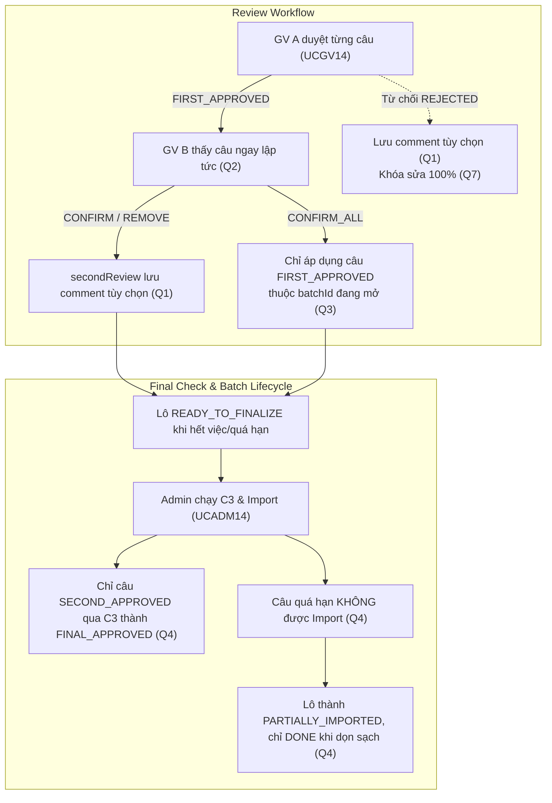

# BIÊN BẢN QUYẾT ĐỊNH THỐNG NHẤT 8 ĐIỂM NGHIỆP VỤ & ĐỒNG BỘ HỆ THỐNG (Q1 — Q8)

* **Ngày lập:** 25/11/2026
* **Trạng thái:** **ĐÃ CHỐT CHÍNH THỨC — CÓ HIỆU LỰC TOÀN NHÓM**
* **Người phê duyệt & thống nhất:** Nhóm phát triển (Đăng & Phương)
* **Căn cứ pháp lý & kỹ thuật:**
  1. Tài liệu rà soát và phản biện ngày 25/11/2026: *Kế hoạch đồng bộ tài liệu hệ thống Adaptive Placement Test*.
  2. Quyết định thay đổi thiết kế Class Diagram và bỏ gói duyệt ngày 03/11/2026 (bổ sung ngày 04/11/2026).
  3. Biên bản RFC-CAT-03 ngày 11/11/2026: *Đồng bộ lệch pha URL S04 và API phiên thi CAT*.
  4. Quyết định kiến trúc #51 (Swagger/OpenAPI), #56 (Lược bỏ lý do từ chối), #122 (`@apt/shared-types`).
  5. Commit cơ sở: `96d10b3` trên nhánh `docs/dong-bo-uc-so-do` repo `0.docs`.
* **Mục tiêu:** Đóng vai trò là **Nguồn sự thật duy nhất (Single Source of Truth)** giải quyết triệt để 8 điểm mở (Q1 — Q8), làm căn cứ pháp lý kỹ thuật để đồng bộ dứt điểm bộ tài liệu (SRS Markdown/Word, Đặc tả Use Case DOCX, Sơ đồ EA XML, Class/Sequence Diagram) và mã nguồn (Prisma Schema, NestJS Backend, Next.js Frontend).

---

## I. TỔNG HỢP QUYẾT ĐỊNH DỨT ĐIỂM (Q1 — Q8)



---

### Q1. Quy định về trường `comment` và lý do từ chối

* **Vấn đề rà soát:** SRS BR-29 có câu viết nháp "không lưu lý do từ chối" (#56), trong khi Schema và DTO đều có trường `comment`.
* **Quyết định chính thức:**
  1. Trường `comment` là **ghi chú nghiệp vụ tùy chọn (optional)** cho cả 3 vai trò: GV vai A (`first_review.comment`), GV vai B (`second_review.comment`), và Admin (khi quyết định lỗi mềm tại bước C3).
  2. Khi thao tác **Từ chối / Loại bỏ** (`REJECT` / `REMOVE`), hệ thống **cho phép nhập** nếu GV muốn để lại lời nhắn (VD: "Sai format", "Đáp án mơ hồ"), nhưng hệ thống **tuyệt đối không bắt buộc (không validate required)**. Người dùng có thể để trống và bấm xác nhận ngay mà không bị chặn form (đúng tinh thần Quyết định #56).
  3. **Hành vi khi bỏ trống:** DB lưu `null` hoặc không có trường `comment` trong payload JSON.
  4. **Quyền xem:** GV A xem ghi chú của A; GV B xem ghi chú của A và B (hỗ trợ đối chiếu); Admin xem được toàn bộ ghi chú trên hệ thống.

---

### Q2. Thời điểm và điều kiện hiển thị câu hỏi cho GV vai B

* **Vấn đề rà soát:** Câu hỏi xuất hiện trong Hộp việc của B ngay khi A duyệt hay phải chờ A hoàn thành toàn bộ lô?
* **Quyết định chính thức:**
  1. Kế thừa **Quyết định bỏ gói ngày 03/11/2026**: Cơ chế "Gói duyệt" (`ItemPackage`) và nút "Gửi gói cho B" đã bị bãi bỏ hoàn toàn. Quy trình duyệt vận hành theo cơ chế **cuốn chiếu liên tục (streaming workflow)** trên từng thực thể `Item`.
  2. **Thời điểm hiển thị:** GV B nhìn thấy câu hỏi trong Hộp việc (màn S34, S35) **ngay lập tức khi GV A bấm Duyệt câu đó** (trạng thái chuyển thành `FIRST_APPROVED`).
  3. **Điều kiện truy vấn Backend (`confirm-item.use-case.ts`):**
     $$\text{WHERE } \text{confirmerId} = \text{teacherId} \text{ AND } \text{status} = \text{'FIRST\_APPROVED'}$$
  4. Xóa bỏ hoàn toàn mọi câu chữ "chờ xác nhận" còn sót lại trong tài liệu cũ để đồng bộ tuyệt đối với mã nguồn.

---

### Q3. Phạm vi và cơ chế an toàn cho thao tác "Xác nhận tất cả" (`CONFIRM_ALL`)

* **Vấn đề rà soát:** Nút "Xác nhận tất cả câu còn lại" tác động trên phạm vi nào? Xử lý đồng thời và ghi log ra sao?
* **Quyết định chính thức:**
  1. **Phạm vi tác động:** Chỉ áp dụng cục bộ trong **Lô (`batchId`) đang mở trên giao diện màn S35** (`/teacher/tasks/confirms/[batchId]`), tuyệt đối không tác động xuyên lô hay toàn bộ hộp việc của GV B.
  2. **Điều kiện lọc dữ liệu cập nhật:**
     $$\text{WHERE } \text{batchId} = :batchId \text{ AND } \text{confirmerId} = :teacherId \text{ AND } \text{status} = \text{'FIRST\_APPROVED'}$$
  3. **Cơ chế an toàn & Xử lý đồng thời (Concurrency):**
     - Thực thi trong một Database Transaction duy nhất (`$transaction`).
     - Chỉ chuyển các câu thỏa mãn điều kiện sang `SECOND_APPROVED`. Những câu A chưa duyệt (còn `DRAFT`) hoặc câu của GV khác phụ trách không bị ảnh hưởng.
  4. **Nhật ký kiểm toán (Audit Log):** Ghi đúng **1 bản ghi** vào bảng `item_review_events` với:
     - `action` = `CONFIRM_ALL`
     - `batch_id` = `batchId` (NOT NULL)
     - `item_id` = `NULL`
     - `actor_id` = `teacherId`
     - `details` (JSON) = `{ updatedCount: number, itemIds: string[] }`.

---

### Q4. Điều kiện kết thúc Lô (`READY_TO_FINALIZE`, `DONE`) và xử lý câu tồn đọng quá hạn

* **Vấn đề rà soát:** Sự khác biệt giữa câu quá hạn chưa duyệt với câu đủ điều kiện Import; trạng thái lô sau khi Import.
* **Quyết định chính thức:**
  1. **Điều kiện đạt `READY_TO_FINALIZE`:** Khi toàn bộ câu trong lô đã được GV xử lý xong vòng 2 (đạt `SECOND_APPROVED` hoặc `REJECTED`), **HOẶC** thời hạn của vòng 2 đã hết mà vẫn còn câu chưa xử lý (quá hạn).
  2. **Tập câu được phép Import vào Ngân hàng câu hỏi (`UCADM14`):**
     - **CHỈ NHỮNG CÂU** ở trạng thái `SECOND_APPROVED` và vượt qua kiểm tra C3 (hoặc được Admin chấp nhận lỗi mềm) mới được chuyển thành `FINAL_APPROVED` và nạp vào ngân hàng câu hỏi chính thức.
     - **TUYỆT ĐỐI CẤM IMPORT** các câu chưa xử lý (đang dừng ở `DRAFT` hoặc `FIRST_APPROVED`) dù đã quá hạn.
  3. **Trạng thái vòng đời của Lô (`ItemBatch.status`):**
     - **Trường hợp 1 (Lý tưởng):** Nếu 100% câu hỏi trong lô đều đạt trạng thái cuối (`FINAL_APPROVED` hoặc `REJECTED`), lô chuyển thành **`DONE`**.
     - **Trường hợp 2 (Còn câu quá hạn chưa duyệt):** Sau khi Import các câu đạt, trạng thái lô chuyển thành **`PARTIALLY_IMPORTED`** (chưa được đóng thành `DONE`). 
     - **Xử lý phần tồn đọng:** Admin có 2 hướng xử lý cho các câu quá hạn:
       - *(a) Khắc phục:* Chỉnh hạn hoặc Giao lại (`REASSIGN`) cho GV khác duyệt tiếp. Sau khi duyệt xong đợt bổ sung, Admin chạy lại C3 và Import đợt 2.
       - *(b) Đóng dứt điểm:* Admin bấm "Hủy bỏ các câu còn lại" $\rightarrow$ Hệ thống chuyển các câu chưa xử lý thành `REJECTED`. Lúc này, khi toàn bộ câu đã ở trạng thái cuối, lô chính thức chuyển thành **`DONE`**.

---

### Q5. Cơ chế tính hạn của GV B và ghi nhật ký kiểm toán khi Admin chỉnh hạn

* **Vấn đề rà soát:** Cách tính hạn của B so với A; hành vi khi Admin chỉnh hạn và loại sự kiện kiểm toán.
* **Quyết định chính thức:**
  1. **Mốc tính hạn chuẩn:** Hạn của cả GV A và GV B được **xác định cố định ngay tại thời điểm Admin phân công giao việc** (`UCADM13`):
     $$\text{first\_review.dueAt} = \text{assignedAt} + \text{reviewDays} \quad (\text{chốt lúc } 23:59:59 \text{ GMT+7})$$
     $$\text{second\_review.dueAt} = \text{assignedAt} + \text{confirmDays} \quad (\text{chốt lúc } 23:59:59 \text{ GMT+7})$$
     - Ràng buộc cấu hình: $\text{confirmDays} > \text{reviewDays}$ (bảo đảm B luôn có khoảng thời gian đệm sau hạn của A).
     - **Không thả nổi hạn của B theo lúc A bấm duyệt** nhằm tránh việc 1 lô có hàng chục hạn lẻ tẻ, làm trôi hạn vô tận và gây xung đột/lỗi hàng đợi gửi mail nhắc của BullMQ.
  2. **Khi Admin chỉnh hạn:**
     - Hệ thống tính lại `dueAt` cho các câu chưa xử lý, hủy job nhắc cũ trên BullMQ và tạo job nhắc mới theo hạn mới.
     - **Loại sự kiện Audit:** Bảng `item_review_events` ghi nhận action **`UPDATE_DUE_DATE`** (thay thế cho `EXTEND` cũ của thời còn Gói). Trường `details` ghi rõ: `{ oldDueAt, newDueAt, updatedBy, reason }`.

---

### Q6. Kiến trúc định tuyến phòng thi S04 và cơ chế bảo mật chống IDOR

* **Vấn đề rà soát:** Thống nhất định tuyến URL S04 giữa `roundId` và `sessionId`, giải pháp bảo mật phiên thi.
* **Quyết định chính thức (Kế thừa 100% RFC-CAT-03 ngày 11/11/2026):**
  1. **URL Phòng thi chuẩn:** Giữ nguyên **`/student/exams/[roundId]/take`** trên giao diện Frontend Next.js (Sinh viên chỉ biết ID kỳ thi được cấp, không lộ `sessionId`).
  2. **Cơ chế chống IDOR (Insecure Direct Object Reference):**
     - Tuyệt đối không dùng URL `/exams/[sessionId]` vì sinh viên có thể đoán hoặc sửa ID trên URL để xem/thi hộ bài của thí sinh khác.
     - Khi vào phòng thi, Frontend gọi endpoint an toàn:
       $$\text{GET } \text{/api/v1/exam-rounds/:roundId/session/current}$$
     - Backend trích xuất `studentId` trực tiếp từ **JWT Bearer Token** (đã xác thực), tìm phiên thi `IN_PROGRESS` của chính sinh viên đó trong kỳ thi `roundId`.
  3. **Hành vi F5 / Reload / Mất kết nối:** Sinh viên tải lại trang vẫn ở URL `/student/exams/[roundId]/take`, Frontend gọi lại API trên để lấy lại đúng trạng thái bài thi, câu hỏi hiện tại và thời gian còn lại để làm tiếp (khớp với Use Case `UCSV07`).
  4. **Khi nộp bài / Hoàn thành:** Sau khi submit câu cuối cùng hoặc hết giờ, hệ thống đóng phiên thi (`status = 'COMPLETED'`) và client điều hướng sang màn hình kết quả **`/results/[sessionId]`** (Màn S05). Lúc này phiên thi đã khóa, không còn rủi ro IDOR can thiệp kết quả.

---

### Q7. Khóa quyền chỉnh sửa của GV A sau khi đã có quyết định

* **Vấn đề rà soát:** GV A có được phép sửa lại câu hỏi sau khi đã chọn Duyệt hoặc Từ chối?
* **Quyết định chính thức:**
  1. **Khóa sửa tuyệt đối 100%:** Một khi câu hỏi đã chuyển trạng thái sang `FIRST_APPROVED` hoặc `REJECTED`, GV vai A **hoàn toàn mất quyền chỉnh sửa** nội dung, đáp án và giải thích của câu hỏi đó.
  2. **Quy tắc kiểm soát mã nguồn:** Use Case `edit-item.use-case.ts` kiểm tra nghiêm ngặt:
     ```typescript
     if (item.status !== ItemStatus.DRAFT) {
       throw new BadRequestException('Chỉ có thể chỉnh sửa câu hỏi khi đang ở trạng thái DRAFT');
     }
     if (item.reviewerId !== currentTeacherId) {
       throw new ForbiddenException('Bạn không được phân công chỉnh sửa câu hỏi này');
     }
     ```
  3. GV A chỉ có thể chỉnh sửa lại trong trường hợp duy nhất: Admin thực hiện thao tác Giao lại đặc biệt (`REASSIGN`) chuyển câu hỏi quay về trạng thái `DRAFT`.

---

### Q8. Quy chuẩn cấu trúc và tính toàn vẹn của sự kiện kiểm toán `ItemReviewEvent`

* **Vấn đề rà soát:** Ràng buộc khi nào `ItemReviewEvent.itemId` mang giá trị `NULL`? Cách ghi log thao tác hàng loạt?
* **Quyết định chính thức:**
  1. **Cấu trúc thực thể `ItemReviewEvent` trong CSDL:**
     - `id`: String (UUID / CUID, Khóa chính)
     - `batch_id`: String (**NOT NULL**, Khóa ngoại tới `item_batches`)
     - `item_id`: String (**NULLABLE**, Khóa ngoại tới `items`)
     - `actor_id`: String (**NOT NULL**, Khóa ngoại tới `users`)
     - `action`: Enum `ReviewAction`
     - `created_at`: DateTime (Mặc định `now()`)
     - `details`: Json (**NULLABLE**, Lưu trữ metadata bổ sung)
  2. **Quy tắc phân định giá trị `item_id`:**
     * **Sự kiện cấp từng câu (Item-level Actions):** `APPROVE`, `REJECT`, `CONFIRM`, `REMOVE`, `EDIT`.
       $\rightarrow$ Trường `item_id` **BẮT BUỘC CÓ** (`NOT NULL`).
     * **Sự kiện cấp cả Lô (Batch-level Actions):** `ASSIGN`, `CONFIRM_ALL`, `IMPORT`, `UPDATE_DUE_DATE`.
       $\rightarrow$ Trường `item_id` **MANG GIÁ TRỊ `NULL`**, trường `details` lưu trữ danh sách các câu bị tác động hoặc tham số thay đổi (VD: `{ affectedCount: 25, itemIds: [...] }`).

---

## II. MA TRẬN ĐỐI CHIẾU & ĐỒNG BỘ TÀI LIỆU DỰ ÁN

| Hạng mục tài liệu | Trạng thái hiện tại | Trách nhiệm thực hiện theo Quyết định này |
|:---|:---|:---|
| **`SRS_TLCN_v3.0.md`** | Đã cập nhật commit `96d10b3` | Rà soát dứt điểm F-27, BR-25, BR-26, Mục 9b.14 khớp 100% với Q1–Q8. |
| **`SRS_TLCN_v3.0.docx`** | Bản Word cũ còn tàn dư gói | Cập nhật bản Word chính thức theo nội dung của bản Markdown đã duyệt. |
| **`20261016_MoHinhHoaYeuCau.docx`** | Đã chuẩn hóa 30 Use Case | Bổ sung phụ lục ghi chú Q1–Q8 vào các bảng đặc tả UCGV14, UCGV15, UCADM13, UCADM14. |
| **`AdaptivePlacementTest.xml`** | Đã dọn sạch 30 UC chuẩn UML | Giữ nguyên (đã khớp 100% với quyết định bỏ gói và quan hệ extend). |
| **Class Diagram (draw.io/puml/mmd)** | Đã chuẩn hóa ngày 24/11 | Giữ nguyên cấu trúc `ItemReviewEvent.itemId {nullable}` theo đúng Q8. |
| **Sequence Diagram (SD03, SD11, SD12)** | Đã cập nhật nhãn ngày 24/11 | Kiểm tra các thông điệp: SD03 (Q2, Q7), SD11 (Q5), SD12 (Q4). |
| **UI Spec (`design/ui/`)** | Đã cập nhật commit `96d10b3` | Đảm bảo mô tả màn S34, S35, S11, S04 phản ánh đúng Q2, Q3, Q6. |
| **Mã nguồn Backend (`backend/`)** | Nhánh `feat/teacher-item-review` | Chuẩn hóa DTO, validator và repository khớp với Q1, Q3, Q7, Q8. |
| **Mã nguồn Frontend (`frontend/`)** | Đang chuẩn bị đồng bộ OpenAPI | Sử dụng type sinh từ `openapi.json`, áp dụng route phòng thi theo Q6. |

---

## III. HIỆU LỰC THI HÀNH

1. Quyết định này có hiệu lực ngay lập tức kể từ ngày ký (25/11/2026).
2. Toàn bộ các thảo luận, ghi chú nháp hoặc đề xuất trước ngày 25/11/2026 có nội dung trái với quyết định này đều **bị bãi bỏ**.
3. Các tài liệu trong thư mục `drafts/` được xem là tài liệu tham khảo lịch sử quá trình phân tích, không có giá trị phủ quyết quyết định này.
4. Nhóm phát triển sử dụng văn bản này làm cơ sở nghiệm thu cho PR `feat/be-x2-openapi` và PR `feat/teacher-item-review`.
